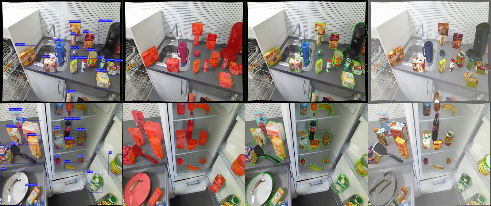

# The KITchen Benchmark

[**Paper**](https://doi.org/10.1109/Humanoids58906.2024.10769947) (Humanoids 2024) ·
[**Website**](https://kitchen-dataset.github.io/KITchen/)



Frozen splits, ground truth, and one evaluation command for the KITchen RGB-D
dataset. Three tasks, all scored with the community's standard protocols so
existing methods and tools plug in unchanged:

| Task | What you predict | Score (primary first) | Protocol |
|---|---|---|---|
| `det` 2D object detection | boxes + class + score | **AP**, AP50, AP75, APs/m/l, AR300 | COCO |
| `segm` instance segmentation | RLE masks + class + score | **AP**, AP50, AP75, APs/m/l, AR300 | COCO |
| `pose` 6D object pose | R, t (mm) + object id + score | **AP_6D** = mean(AP_MSSD, AP_MSPD); AR_6D | BOP 2024 / BOP 2019 |

The design, the reasons behind it, and the rules are in [BENCHMARK.md](BENCHMARK.md).

## Quick start

```bash
pip install git+https://github.com/KITchen-Dataset/KITchenBenchmark@v1.0   # numpy + pycocotools; nothing to compile
# ground truth, splits and evaluation models: one archive on the v1.0 release
wget https://github.com/KITchen-Dataset/KITchenBenchmark/releases/download/v1.0/kitchen_bench_v1.0.zip
unzip kitchen_bench_v1.0.zip
kitchenbench verify kitchen_bench_v1.0        # your ground truth is the frozen one
```

The v1.0 ground truth checksum is `665635036314` (full value in `benchmark.json`;
poses from release `v3.3`). The archive's sha256 is `8e5373bc185352a91ddcf72470a2bb8da4efd66cba2ffa7f1eb44af188395c7d`
(327 MB).

**Split.** Train is the first kitchen of the recordings (a lab room); val and
test are the second, a built-in kitchen, so every score measures a method in a
kitchen it has never seen. Whole table setups go to one split. Every val and
test frame is scored: 377,846 pose targets in test. Details in
[BENCHMARK.md](BENCHMARK.md#2-splits).

1. **Train** on `coco/train.json` (boxes and polygons) or on the BOP-format
   annotations; images are `KITchen_rgb_<N>/images/<stem>.png` of the release.
   Tune on `val`. Never train or tune on `test` frames.
2. **Predict** on the frames listed in `splits/test_eval.txt` (all test frames).
   * `det` / `segm`: a COCO results list, `image_id` = the frame number
     (`int(stem)`), `category_id` = KITchen class id (1-111), boxes in pixels
     `[x, y, w, h]`, masks as COCO RLE.
   * `pose`: a BOP19 CSV `scene_id,im_id,obj_id,score,R,t,time` with R row-major,
     t in millimetres, `time` the wall time in seconds for the whole image
     (same on every row of that image; required).
     `scene_id` = `im_id // 250`, `im_id` = the frame number.
3. **Check and score**:

```bash
kitchenbench method-template > method.json     # fill in name, input, training data
kitchenbench validate kitchen_bench_v1.0 pose my_poses.csv
kitchenbench eval     kitchen_bench_v1.0 pose my_poses.csv --method method.json
```

`eval` prints the scores and writes a **result card** (`results/<name>_pose_test.json`
plus `.md` and `.tex` rows ready for a paper). The card records the benchmark
version, the checksum of the ground truth, the checksum of your prediction
file, and the evaluator version, so anyone can reproduce the number.

## Reporting

* Report the primary score of each task you evaluate, on `test`, with the
  benchmark version (e.g. "KITchen v1.0 AP_6D = 61.3").
* State the input (RGB or RGB-D) and the training data; the leaderboard ranks
  RGB and RGB-D methods separately.
* Pose methods follow the two rules of the KITchen paper: **one model for all
  objects** and **at least 5 fps**. The result card reports both; methods that
  meet them rank first.
* To appear on the leaderboard, open an issue on this repository with the
  result card JSON attached (and, ideally, the prediction file). The
  leaderboard is generated from cards with `kitchenbench leaderboard cards/*.json`.

## Example pipeline

`baselines/` holds a YOLO11m-seg pipeline that shows the whole loop for `det`
and `segm`: `prep_yolo.py` writes the training set, `train_capped.py` trains,
`yolo_predict.py` writes the prediction files, and `kitchenbench eval` scores
them. v1.0 publishes no official baseline numbers.

## Citing

Please cite the KITchen dataset paper and state the benchmark version.

```bibtex
@inproceedings{younes2024kitchen,
  title     = {{KITchen}: A Real-World Benchmark and Dataset for {6D} Object Pose Estimation in Kitchen Environments},
  author    = {Younes, Abdelrahman and Asfour, Tamim},
  booktitle = {2024 IEEE-RAS 23rd International Conference on Humanoid Robots (Humanoids)},
  pages     = {803--810},
  year      = {2024},
  doi       = {10.1109/Humanoids58906.2024.10769947},
}
```

## For maintainers

`kitchenbench propose-symmetries` and `kitchenbench build` freeze a new version
from a KITchen release; see the docstring of `kitchenbench/build.py`. A version
is never rebuilt in place: new annotations mean a new version number.
Tests: `pip install -e .[test] && pytest` (the BOP parity tests also need
`bop_toolkit_lib`).
